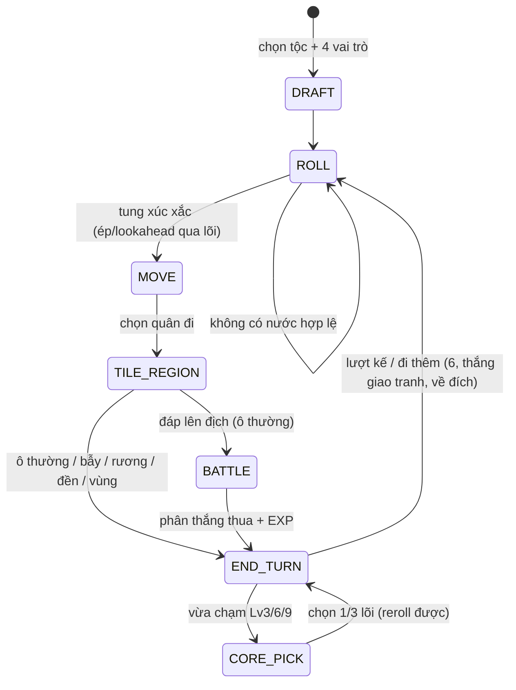

# Cá Ngựa Chiến Thần — Game Design Document

| Mục | Giá trị |
|---|---|
| Phiên bản | 1.0 |
| Cập nhật | 2026-09-06 |
| Trạng thái | Engine luật hoàn thành, 110/110 test xanh; chưa đóng gói build |
| Phạm vi | GDD đầy đủ cho bản web hot-seat 2–4 người (pass-and-play), UI tiếng Việt |
| Quy ước | `[Đề xuất]` = phương án mặc định do tài liệu này bổ sung, chưa nằm trong tài liệu gốc. `[Cần chốt]` = quyết định thiết kế còn ngỏ. Toàn bộ tập hợp tại mục 11. |

Tài liệu gốc là bản tóm tắt ý tưởng; mọi số liệu trong đó được giữ nguyên. Phần mở rộng chỉ bổ sung diễn giải, hình học mặc định, tương tác giữa các cơ chế, và các điểm cần quyết định — không thay đổi số liệu gốc.

---

## 1. Tóm tắt & điểm bán độc đáo

**Cá ngựa (Ludo) × RPG**: mỗi quân cờ là một anh hùng có hệ + tộc. Người chơi draft đội hình, nhận cộng hưởng động theo số quân còn trên sân, chọn lõi nâng cấp khi lên cấp, di chuyển qua 4 vùng đất biến đổi luật chơi, và **bắt quân = giao tranh** thay vì tự động về chuồng.

Vòng lõi của trò chơi: *đi để tạo vị thế → vị thế bật cộng hưởng/vùng → dùng lợi thế giao tranh → giao tranh đổi EXP & cấp → cấp mở skill & lõi → thay đổi cách đi*. Mỗi vòng lặp tác động lên vòng khác, và cả hai chiều: mất quân là mất cộng hưởng thật, nên Leading Player bị áp lực bảo toàn lực ngược chiều với snowball.

### 1.1 Điểm bán độc đáo (USP)

| # | USP | Vì sao thú vị |
|---|---|---|
| 1 | **Bắt quân = giao tranh 1 hiệp** | Không còn "đáp là bay về chuồng" — phe tấn công phải tính `d6 + ATK` so với `d6 + DEF + 1`, thắng mới đuổi được địch. DEF +1 cho chủ chốt khiến đánh người đang có lợi thế địa lý là rủi ro thật |
| 2 | **Cộng hưởng động** | Đội hình tộc thuần 4 quân bật cộng hưởng 2/4 quân; bị bắt = mất cộng hưởng thật → lối chơi bảo toàn lực, tính từng quân trước khi đánh |
| 3 | **Lõi "kỳ dị nhưng có ích"** | Không có lõi "+10% chỉ số" — mỗi lõi là một đánh đổi (nhược thật, lợi lớn) hoặc một cơ chế mới lạ chưa tồn tại ở hệ thống nào khác trong game |
| 4 | **Khế Ước Tàn Đoàn** | Càng ít quân còn chạy càng mạnh (+ATK, ngưỡng 2 và 1 quân) → comeback ngược chiều snowball |
| 5 | **4 vùng đất** | Mỗi cung 13 ô trên đường vòng là một vùng có luật riêng + affinity tộc → vị thế địa lý là một tài nguyên có thể chiếm và mất |

---

## 2. Luật nền (khung cá ngựa truyền thống)

Phần này giữ nguyên khung cá ngựa; thay đổi cốt lõi: **đáp lên địch ở ô thường → giao tranh 1 hiệp** (mục 2.4) thay vì quân bị đáp tự động về chuồng.

### 2.1 Bàn cờ & hệ tọa độ

- Bàn 15×15: **52 ô đường vòng** + 6 ô đường về/người + chuồng 4 quân ở 4 góc.
- Đường vòng đánh số `r = 0..51`, đi một chiều quanh bàn `[Đề xuất]`. Người chơi `i` (i = 0..3) xuất phát tại ô `r = 13·i`, ngồi theo thứ tự Bắc → Đông → Nam → Tây.
- Mỗi quân mang **chỉ số tiến độ** `p` theo góc nhìn của phe chủ nhân, `p = 0..57` `[Đề xuất]`:
  - `p = 0..51`: ô vòng, ánh xạ `r = (13·i + p) mod 52`;
  - `p = 52..56`: 5 ô đường về màu của phe `i`;
  - `p = 57`: ô đích. Như vậy "6 ô đường về/người" = 5 ô di + ô đích.
- **Vùng đất** gắn với cung, không gắn với người chơi: cung `k` gồm 13 ô `r ∈ [13k, 13k+12]`; mỗi phe đi qua đủ 4 vùng mỗi vòng.

Lợi thế hình học: ô xuất phát của mình nằm trong cung của phe khác — không ai hưởng affinity vùng ngay từ đầu, mọi phe phải tranh từng vùng theo tiến độ vòng.

### 2.2 Xúc xắc & nước đi

- Tung **6** để ra quân (đặt tại `p = 0`); tung 6 được **đi thêm lượt**.
- **3 lần 6 liên tiếp** trong một chuỗi tung → mất lượt, chuỗi đếm reset.
- Về đích phải tung **đúng số bước còn thiếu**: `d = 57 − p`. Tung thừa → quân đó không có nước đi với số này (không lùi, không dùng dư).
- Không có nước hợp lệ nào với kết quả tung → `[Cần chốt D1]`; đề xuất mặc định: **tung lại trong cùng lượt**, không tốn lượt mới và không tăng chuỗi 6.

### 2.3 Ô sao an toàn & chồng quân

- **8 ô sao** `[Đề xuất vị trí]`: 4 ô xuất phát (`r ≡ 0 mod 13`) + 4 ô giữa cung (`r ≡ 8 mod 13`).
- Đứng trên ô sao: không thể bị bắt, không thể bị Xạ Kích nhắm tới. Giao tranh không thể khởi phát với mục tiêu trên ô sao.
- Chồng quân `[Đề xuất]`: cho phép nhiều quân cùng phe đứng chung ô ở mọi loại ô; đáp vào ô có quân địch lẫn quân mình → chỉ giao tranh với 1 quân địch do phe tấn công chọn `[Cần chốt D2]`.

### 2.4 Giao tranh (thay thế luật bắt quân)

Khởi phát: quân di chuyển đến/đứng trên ô thường có quân địch (không phải ô sao), hoặc bị Xạ Kích nhắm tới (mục 3.2). Một hiệp, tổng thời gian trình chiếu (roll, breakdown, kết quả) **≤ 10 giây** `[Cần chốt D3: đề xuất engine tự giải, không có mini-game can thiệp]`.

```
attackerScore = d6 + ATK + mod(skill/lõi/cộng hưởng/vùng)  [+ crit ×2]
defenderScore = d6 + DEF + 1 + mod                          // chủ chốt +1, hòa nghiêng thủ
```

- `mod` gộp mọi hiệu chỉnh từ skill, lõi, cộng hưởng, Tàn Đoàn, vùng, đền, item — tính theo pipeline cố định (mục 5.4), có breakdown trong tooltip.
- **Chí mạng**: Sát thủ 25% cơ hội chí mạng, điểm roll giao tranh ×2. Phạm vi nhân đôi `[Cần chốt D4]`; đề xuất: chỉ nhân đôi xúc xắc `d6` (giới hạn độ biến động). **Rừng Nguyên Sinh vô hiệu crit** (mục 4.1).
- **Phân thắng bại**:
  - `attackerScore > defenderScore` → **phía tấn công thắng**: quân bị đánh về chuồng (hồi đầy HP, giữ cấp và item — trừ khi bị Vơ Đồ cướp trước đó `[Đề xuất]`). Phe thắng +50 EXP (quân thắng +100 nếu giữ Săn Đầu Ấm và cấp địch ≥ cấp mình).
  - `defenderScore ≥ attackerScore` (kể cả hòa — chủ chốt +1 khiến hòa nghiêng về thủ) → **phía thủ thắng**: quân tấn công quay về ô xuất phát của bước đi (không mất ô), trừ HP theo sát thương `[Cần chốt D5]`; đề xuất: sát thương = `defenderScore − attackerScore`, tối thiểu 1, chỉ áp khi thua thật (hòa: quay về ô cũ, không trừ HP). Quân tấn công chỉ về chuồng khi HP về 0.
- **EXP an ủi**: thua giao tranh vẫn +10 EXP (trừ khi phe thua giữ Săn Đầu Ấm).
- **Các nguồn chặn/phản giao tranh**: Khiên Thành Chủ (skill Hiệp sĩ), Bóng Đêm (skill Sát thủ), Gương Bóng Tử Địa (lõi phản đòn), ô sao (miễn nhiễm tuyệt đối), Rừng Nguyên Sinh (chặn Xạ Kích).

Ví dụ `[Đề xuất minh họa]`: Sát thủ tộc Yêu (ATK 4 + 1 tộc = 5) tấn công Hiệp sĩ tộc Long (DEF 3 + 1 tộc = 4): tung `d6 = 4` → attackerScore = 9; phía thủ tung `d6 = 3` → defenderScore = 3 + 4 + 1 = 8. Tấn công thắng, Hiệp sĩ về chuồng.

### 2.5 Điều kiện thắng

Người chơi đầu tiên đưa **cả 4 quân về đích** thắng trận. Quân đã về đích ("phong thần") vẫn tính vào cộng hưởng tộc nhưng không tính vào Khế Ước Tàn Đoàn (mục 3.4) và không di/skill nữa.

---

## 3. Lớp RPG

### 3.1 Draft đội hình — tộc trước, vai trò sau

- **Bước 1:** chọn 1 trong 4 tộc (Người / Tiên Linh / Yêu / Long).
- **Bước 2:** chọn 4 vai trò **không trùng** (Hiệp sĩ / Pháp sư / Cung thủ / Sát thủ) → đội hình tộc thuần, mỗi hệ đúng 1 quân.
- **Hệ quả:** cộng hưởng tộc ×2/×4 luôn bật khi đủ quân trên sân; **cộng hưởng hệ** (đôi cùng hệ) chỉ bật ở biến thể draft tự do (mục 8.3). Hiệu ứng cụ thể của cộng hưởng hệ chưa định nghĩa → `[Cần chốt D12]`.

### 3.2 Bốn hệ (class) — chỉ số gốc Lv1

| Hệ | HP | ATK | DEF | Đặc tính |
|---|---|---|---|---|
| Hiệp sĩ | 12 | 3 | 3 | Miễn nhiễm bẫy |
| Pháp sư | 7 | 5 | 1 | Skill mạnh, CD dài |
| Cung thủ | 8 | 4 | 1 | **Xạ Kích**: bắn địch cách 3–5 ô, không cần đáp xuống |
| Sát thủ | 8 | 4 | 1 | 25% chí mạng (×2 điểm roll giao tranh) |

Chi tiết Xạ Kích `[Đề xuất]`: tính khoảng cách theo đường vòng; mục tiêu trong Rừng Nguyên Sinh không thể bị bắn; Xạ Kích tốn nước di của lượt (thay vì di chuyển) và mở giao tranh đầy đủ với công thức mục 2.4 (Cung thủ là attacker, không hưởng crit).

### 3.3 Bốn tộc — đặc tính cá nhân + affinity vùng + cộng hưởng

| Tộc | Cá nhân | Affinity vùng | Cộng hưởng 2 quân trên sân | Cộng hưởng 4 quân |
|---|---|---|---|---|
| **Người** | +1 HP | Thung Lũng hồi 2 | +1 DEF toàn đội | Đầu lượt: toàn đội hồi 1 HP |
| **Tiên Linh** | Miễn bẫy | Rừng +1 DEF | CD skill Tiên Linh −1 | 1 lần/lượt: hoán đổi 2 Tiên Linh cách ≤ 6 ô |
| **Yêu** | +1 ATK | Sa Mạc miễn cháy +1 ATK | Thắng giao tranh: hồi 2 HP | +2 điểm roll khi TẤN CÔNG |
| **Long** | +1 DEF | Vực Băng miễn −1 roll +1 DEF | Ra chuồng chỉ cần ≥ 5 | Tung 6: chọn thêm 1 quân đi 3 ô |

Diễn giải & tương tác:

- **Đếm "trên sân"** = quân trên đường vòng + đường về + đã về đích (phong thần vẫn tính). Chuồng không tính → bị bắt là mất cộng hưởng thật.
- Tộc cá nhân cộng thẳng vào chỉ số gốc (pipeline bước 2, mục 5.4). Ví dụ đội Long: Hiệp sĩ 12/3/4, Pháp sư 7/5/2, Cung thủ 8/4/2, Sát thủ 8/4/2.
- **Yêu 2 quân** ("thắng giao tranh hồi 2 HP") `[Đề xuất]`: áp cho quân Yêu vừa thắng, bất kể vai trò tấn công hay thủ.
- **Long 2 quân** ("ra chuồng chỉ cần ≥ 5"): tung 5 hoặc 6 đều ra quân được; riêng lần tung 6 vẫn giữ nguyên luật tung-6-đi-thêm (đi thêm đúng 1 lần, không nhân đôi).
- **Long 4 quân**: cộng với luật tung-6-đi-thêm: lượt đó chọn 1 quân khác đi 3 ô, rồi vẫn nhận nước đi chính của xúc xắc.
- **Tiên Linh 4 quân** (hoán đổi 2 quân cùng phe cách ≤ 6 ô): không dùng được với quân trong chuồng/đã về đích.

### 3.4 Khế Ước Tàn Đoàn — comeback ngược snowball

Ngưỡng tính theo **quân còn chạy** = quân trên đường vòng + đường về (không tính chuồng, không tính đã về đích — khác với đếm "trên sân" của cộng hưởng):

| Quân còn chạy | Trạng thái | Hiệu ứng |
|---|---|---|
| 3–4 | Trận thế đầy đủ | — |
| 2 | Khuyết tuyến | Mỗi quân +1 ATK |
| 1 | Cô Hành Hiệp Sĩ | Quân sống sót +2 ATK, +2 DEF |

Tính lại động mỗi khi có quân bị bắt hoặc về đích. Người dẫn đầu bị bắt mất quân → tự mất cộng hưởng tộc **và** đối thủ yếu hơn hưởng Tàn Đoàn: hai áp lực cân bằng tự nhiên theo hai chiều.

### 3.5 Lõi nâng cấp — chọn lúc Lv3 / Lv6 / Lv9

- **Trigger:** lần đầu **bất kỳ quân nào** của phe chạm mốc cấp (3, 6, 9) → random 3 lõi từ 12, chọn 1, được **reroll 1 lần/mốc**. Tối đa 3 lõi/trận, mỗi lõi chỉ chọn được 1 lần/phe.
- **Hai nhóm ngân sách ngang nhau** (≈ 1 thụ động mạnh):
  - **(A) Đánh đổi** — giá thật, đo được;
  - **(B) Kỳ dị** — cơ chế chưa tồn tại ở bất kỳ hệ thống nào khác trong game.

Diễn giải từng lõi (lợi/giá giữ nguyên từ tài liệu gốc; diễn giải & tương tác do GDD bổ sung):

#### Nhóm A — Đánh đổi

1. **Huyết Khế** — Lợi: +3 ATK toàn đội. Giá: −2 maxHp toàn đội vĩnh viễn. Tương tác: maxHp giảm không làm mất HP hiện tại nhưng mọi hồi máu chặn ở max mới; hiệu ứng Sa Mạc (không giảm dưới 1 HP) vẫn áp.
2. **Giáp Sét Gỉ** — Lợi: đầu lượt hồi 2 HP toàn đội. Giá: −2 DEF toàn đội. Tương tác: cộng dồn với hồi đầu lượt của vùng Thung Lũng (+1) và cộng hưởng Người 4 quân (+1).
3. **Ánh Sáng Trừng Phạt** — Lợi: địch bị giảm thêm DEF khi giao tranh với phe giữ lõi `[Cần chốt D6 mức giảm: đề xuất −2]`. Giá: quân phe giữ lõi không được đứng/đáp lên ô an toàn. Tương tác mâu thuẫn với ô xuất phát (là ô sao) → `[Cần chốt D7]`; đề xuất: miễn áp dụng cho 4 ô xuất phát, chỉ cấm 4 ô sao giữa cung.
4. **Ngọn Đuốc Đêm** — Lợi: +1 ATK toàn đội, cộng thêm +1 khi là phe tấn công. Giá: không hưởng hồi HP từ ô/vùng. Phạm vi "ô/vùng" `[Cần chốt D8]`; đề xuất: chặn hồi từ ô (hồi đầy) và vùng (Thung Lũng), không chặn hồi từ lõi (Giáp Sét Gỉ) và cộng hưởng tộc.

#### Nhóm B — Kỳ dị

5. **Nợ Máu Thần Xác Suất** — Lợi: mỗi lượt di được 2 quân, chia số bước của 1 roll cho 2 quân (mỗi quân ≥ 0 bước, tổng đúng bằng roll). Giá: mỗi roll −1 `[Cần chốt D9 phạm vi]`; đề xuất: mọi roll của phe giữ lõi (cả di chuyển lẫn giao tranh) đều −1.
6. **Gương Bóng Tử Địa** — Lợi: khi thua giao tranh, quân thắng (kẻ vừa bắt) cũng bị đẩy về chuồng. Giá: mỗi quân phe mình chỉ kích hoạt được 1 lần/trận. Tương tác: tạo thế "quân ngầu" — địch phải tính giá của mỗi lần thắng.
7. **Con Mắt Tiên Tri** — Lợi: nhìn trước kết quả xúc xắc của phe khác (UI hiển thị roll kế tiếp). Giá: chỉ được dùng 1 lần/trận để đổi 1 kết quả (thành số tùy chọn 1–6). Tương tác hot-seat: thông tin nhìn trước phải che khi truyền máy `[Cần chốt D13]`; đề xuất: chế độ tap-để-mở chỉ hiển thị với phe giữ lõi.
8. **Dòng Chảy Nghịch** — Lợi: mọi bẫy trên bàn biến thành đền +1 ATK (hiệu ứng đổi ô áp cho toàn bàn — cả địch cũng mất bẫy). Giá thực tế: chỉ 2/4 quân còn bị bẫy tác động (Hiệp sĩ miễn nhiễm bẫy, Tiên Linh miễn bẫy) → giá trị bị loãng đúng nửa đội.
9. **Săn Đầu Ấm** — Lợi: thắng giao tranh chống địch cấp ≥ cấp quân mình: +100 EXP. Giá: thua không được EXP an ủi (+10).
10. **Vua Đơn Côi** — Lợi: 1 quân được chỉ định khi nhận lõi; khi quân đó cách mọi đồng minh cùng phe ≥ 4 ô: +2 ATK, +2 DEF. Giá: chỉ đúng quân được chỉ định mới hưởng.
11. **Chìa Khóa Vũ Trụ** — Lợi: 1 lần/trận, kích hoạt thay nước di `[Đề xuất]`: hoán đổi vị trí 2 quân bất kỳ đang ở trên bàn (mọi phe). Giá: không dùng được với quân trong chuồng hoặc đã về đích.
12. **Kho Báu Bản Đồ** — Lợi: khi nhặt rương, mở 3 lựa chọn và chọn 1 thay vì nhận random. Giá: món trùng (đã có hoặc quân đầy 2 item) → quy đổi +30 EXP.

### 3.6 EXP, cấp, skill, item

**Nguồn EXP (gắn với từng quân):**

| Sự kiện | EXP |
|---|---|
| Thắng giao tranh | +50 |
| Hoàn thành vòng (lần đầu `p` vượt 51) | +20 |
| Về đích | +100 |
| Thua giao tranh (an ủi) | +10 |
| Săn Đầu Ấm thắng địch cấp ≥ | +100 |
| Rương món trùng / Kho Báu quy đổi `[Đề xuất]` | +30 |

**Cấp**: cần `100 × level` EXP cho mỗi cấp, tối đa **Lv10**. Mỗi cấp +1 HP, +0.5 ATK luân phiên — cụ thể hóa `[Đề xuất]`: +1 HP mỗi cấp (Lv2–Lv10), +1 ATK vào các cấp 3/5/7/9 (trung bình +0.5/cấp):

| Cấp | HP | ATK | Ví dụ Hiệp sĩ (HP/ATK) |
|---|---|---|---|
| 1 | — | — | 12 / 3 |
| 2 | +1 | — | 13 / 3 |
| 3 | +1 | +1 | 14 / 4 |
| 4 | +1 | — | 15 / 4 |
| 5 | +1 | +1 | 16 / 5 |
| 6 | +1 | — | 17 / 5 |
| 7 | +1 | +1 | 18 / 6 |
| 8 | +1 | — | 19 / 6 |
| 9 | +1 | +1 | 20 / 7 |
| 10 | +1 | — | 21 / 7 |

Ngưỡng EXP tích lũy để đạt: Lv2 = 100, Lv3 = 300, Lv4 = 600, Lv5 = 1000, Lv6 = 1500, Lv7 = 2100, Lv8 = 2800, Lv9 = 3600, Lv10 = 4500.

DEF không tăng theo cấp. Quân đã về đích vẫn nhận và giữ EXP (chỉ có ý nghĩa khi bị so cấp, ví dụ Săn Đầu Ấm).

**Skill** mở ở Lv3 / Lv5, mỗi hệ 2 skill. Tài liệu gốc nêu 4/8; 4 còn lại lấy danh mục chính thức từ `src/data/skills.ts` khi có repo, hoặc dùng phương án dưới:

| Hệ | Skill Lv3 | Skill Lv5 | CD `[Đề xuất]` |
|---|---|---|---|
| Hiệp sĩ | **Khiên Thành Chủ**: chặn bắt nhắm vào mình trong lượt này | **Xung Phong Trận**: sau khi di xong, đi tiếp 3 ô bắt buộc | 4 / 6 |
| Pháp sư `[Đề xuất]` | **Trói Trận**: chọn 1 quân địch, quân đó không được di ở lượt kế tiếp của chủ nó | **Giác Ngộ**: hồi 3 HP toàn đội, giảm 1 CD mọi skill đồng minh | 6 / 8 |
| Cung thủ `[Đề xuất]` | **Bắn Chân**: Xạ Kích trúng đích → địch mất lượt di kế tiếp | **Tam Liên Kích**: 1 lần bắn 3 mục tiêu khác nhau, mỗi phát là 1 giao tranh đầy đủ | 4 / 8 |
| Sát thủ | **Bóng Đêm**: 1 lượt không thể bị bắt | **Vơ Đồ**: thắng giao tranh → cướp 1 item của địch | 4 / 6 |

Cách kích hoạt `[Cần chốt D11]`; đề xuất: dùng skill thay nước di trong lượt, mỗi lượt tối đa 1 skill, CD đếm theo lượt của phe.

**Item** (tối đa 2/quân, từ rương hoặc cướp):

| Item | Hiệu ứng |
|---|---|
| Kiếm | +1 ATK |
| Khiên | +1 DEF |
| Dược Huyết | Hồi đầy HP ngay trước giao tranh, tự tiêu hao `[Đề xuất]` |
| Ngọc May Mắn | Reroll 1 xúc xắc của mình, dùng chủ động sau khi thấy kết quả `[Đề xuất]` |

---

## 4. Môi trường — 4 vùng đất

Mỗi cung 13 ô trên đường vòng là một vùng. Nguyên tắc áp dụng `[Đề xuất]`: hiệu ứng vùng tính theo **ô của mục tiêu chịu tác động** (quân bị bắt/bị bắn/xảy ra hiệu ứng đầu lượt), không theo ô của người gây.

| Vùng | Cung | Hiệu ứng vùng | Affinity |
|---|---|---|---|
| **Rừng Nguyên Sinh** | Bắc (0) | Không thể bị Xạ Kích; crit vô hiệu | Tiên Linh +1 DEF |
| **Sa Mạc Cháy** | Đông (1) | Đầu lượt chủ ô −1 HP (không dưới 1) | Yêu miễn cháy, +1 ATK |
| **Thung Lũng Sương** | Nam (2) | Đầu lượt chủ ô +1 HP; bẫy vô hiệu | Người hồi 2 |
| **Vực Băng Vĩnh Cứu** | Tây (3) | Tấn công trong vực −1 điểm roll | Long miễn, +1 DEF |

Ghi chú:

- Sa Mạc/Thung Lũng tính đầu lượt cho **mỗi quân đang đứng** trên ô thuộc vùng (không phải mỗi phe).
- Vực Băng: "tấn công trong vực" = attacker phải tính điểm roll −1 khi mục tiêu đứng trong vực `[Đề xuất]`; Long miễn cả hai chiều (không bị trừ, và tính +1 DEF khi đứng trong vực).
- Bẫy vô hiệu ở Thung Lũng: quân dẫm bẫy trong Thung Lũng không bị nhốt; bẫy vẫn còn để tác động ở vùng khác (bẫy thuộc về ô, hiệu ứng theo ô đứng).

### 4.1 Ô đặc biệt đè trên vùng

Tổng 24 ô đặc biệt trên 52 ô vòng: **8 ô sao an toàn · 4 rương · 6 bẫy · 4 đền (+1 ATK) · 2 ô hồi máu đầy**. Bố trí mặc định `[Đề xuất]` — phân bố đều theo offset trong mỗi cung:

| Offset trong cung | Loại ô | Số lượng |
|---|---|---|
| 0 | Ô sao (ô xuất phát) | 4 |
| 3 | Rương | 4 |
| 5 | Bẫy | 4 |
| 6 | Đền | 4 |
| 8 | Ô sao (giữa cung) | 4 |
| 10 — cung Bắc & Nam | Hồi máu đầy | 2 |
| 10 — cung Đông & Tây | Bẫy | 2 |

Quy tắc từng loại:

- **Ô sao**: miễn bắt/Xạ Kích (mục 2.3).
- **Rương**: phải **dừng đúng** ô rương mới mở (đi ngang không nhận) `[Đề xuất]`; mỗi rương chỉ mở 1 lần/trận. Nội dung random 1 trong: Kiếm, Khiên, Dược Huyết, Ngọc May Mắn, +30 EXP `[Đề xuất]`.
- **Bẫy** ("mất lượt di kế"): quân dẫm bẫy không được chọn di ở lượt kế tiếp của phe đó; bẫy vĩnh viễn, dẫm lại bị nhốt lại `[Đề xuất]`. Hiệp sĩ & Tiên Linh miễn; Thung Lũng vô hiệu hóa.
- **Đền (+1 ATK)**: quân đang đứng trên đền được +1 ATK trong mọi giao tranh (cả tấn công lẫn thủ) `[Đề xuất]`.
- **Hồi máu đầy**: dừng đúng ô → hồi toàn bộ HP.

---

## 5. Chế độ, nền tảng & kiến trúc

### 5.1 Chế độ chơi

- **Hot-seat 2–4 người** cùng máy (pass-and-play), UI tiếng Việt.
- Bổ sung `[Đề xuất]`: chế độ đấu máy dùng chính engine auto-play của quy trình cân bằng (mục 7.5); biến thể draft tự do (mục 8.3).

### 5.2 Nền tảng & ràng buộc kỹ thuật

- Web (PC + mobile browser), static hosting, không server.
- **0 dependency runtime** — Vite + TypeScript strict + Canvas 2D thuần; UI overlay DOM/CSS; âm thanh Web Audio tổng hợp.
- Pixel art 100% code-sinh: string-matrix, palette 32 màu, integer upscale.

### 5.3 Kiến trúc

Rules engine thuần ở `src/core/` **không biết canvas tồn tại** → unit-test vitest độc lập; data tách `src/data/`; gfx/ui/audio tách lớp. Đường ranh giới: `core` nhận và trả về plain object; mọi hiệu ứng hiển thị (đường đi hợp lệ, highlight) là dữ liệu do core xuất.

```
src/
  core/     # rules engine thuần: state machine, giao tranh, EXP, RNG có seed
  data/     # classes, tribes, cores, skills, items, regions, board layout
  gfx/      # Canvas render, sprite code-sinh
  ui/       # DOM overlay, tooltip, hot-seat flow
  audio/    # Web Audio tổng hợp
```

### 5.4 Pipeline tính chỉ số (thứ tự cố định)

Mọi buff đa nguồn tính theo đúng thứ tự dưới đây; tooltip breakdown liệt kê từng tầng `[Đề xuất]`:

1. Chỉ số gốc hệ (`data/classes.ts`)
2. Đặc tính cá nhân tộc (+1 HP / +1 ATK / +1 DEF / miễn bẫy)
3. Cấp (+1 HP/cấp; +1 ATK cấp 3/5/7/9)
4. Item (Kiếm +1 ATK, Khiên +1 DEF)
5. Cộng hưởng tộc (2 quân / 4 quân)
6. Cộng hưởng hệ (chỉ biến thể draft tự do)
7. Khế Ước Tàn Đoàn (+1 ATK khi 2 quân; +2/+2 khi 1 quân)
8. Lõi
9. Vùng hiện tại + đền đang đứng
10. Hiệu chỉnh tạm của lượt (Bóng Đêm, Trói Trận, đóng băng bẫy, ...)

---

## 6. Vòng lượt — state machine



Diễn giải từng trạng thái:

| Trạng thái | Trách nhiệm | Ghi chú chuyển |
|---|---|---|
| DRAFT | Chọn tộc, rồi 4 vai không trùng | Mỗi phe làm lần lượt trong hot-seat |
| ROLL | Tung d6; DevMode ép được; Con Mắt Tiên Tri hiển thị trước | Không nước hợp lệ → ROLL lại (D1) |
| MOVE | Chọn quân nhận bước đi (hoặc Xạ Kích/skill thay di) | Nợ Máu cho phép chia 2 quân |
| TILE_REGION | Giải ô đến: thường/bẫy/rương/đền/vùng/hồi | Đáp địch ở ô thường → BATTLE |
| BATTLE | Giải 1 hiệp theo công thức mục 2.4, ≤ 10 giây trình chiếu | Kết quả → EXP, HP, về chuồng |
| CORE_PICK | Random 3 lõi, chọn 1, reroll 1 lần/mốc | Trigger khi có quân chạm mốc Lv3/6/9 |
| END_TURN | Chốt lượt: hồi đầu lượt (lõi/vùng), tick CD, tính Tàn Đoàn | Có nguồn đi thêm → quay về ROLL |

**Nguồn đi thêm lượt**: tung 6 (chuỗi ≤ 2), thắng giao tranh, 1 quân về đích. Chuỗi 6 chỉ đếm kết quả tung = 6 liên tiếp của cùng phe; đi thêm từ thắng giao tranh/về đích không tăng chuỗi `[Đề xuất]`.

---

## 7. Triết lý thiết kế & cân bằng

### 7.1 Parity lõi

Mỗi lõi được chấm cùng một ngân sách sức mạnh khi code (`data/cores.ts` ghi note ngân sách). Lệch → **sửa số liệu, không sửa cơ chế**. Lõi kỳ dị được duy trì "kỳ dị" bằng cách đổi hình dạng lợi ích, không đổi độ lớn.

### 7.2 Chống snowball

- Cộng hưởng mất khi mất quân (đếm trên sân động).
- Tàn Đoàn thưởng phe ít quân chạy.
- EXP an ủi giữ phe thua có đường lên cấp.
- Giao tranh có rủi ro hai chiều (DEF +1, Gương Bóng Tử Địa) → dẫn đầu không dám ép đánh tràn lan.

### 7.3 Chống confusion

- Mọi buff đa nguồn có **breakdown tooltip** theo pipeline 10 tầng cố định (mục 5.4).
- Mọi cơ chế "đếm quân" dùng đúng định nghĩa của nó: cộng hưởng đếm **trên sân** (có đích, không có chuồng); Tàn Đoàn đếm **còn chạy** (không có đích lẫn chuồng). Tooltip nêu rõ đang dùng định nghĩa nào.

### 7.4 DevMode

Công cụ DevMode trong HUD: ép xúc xắc, đặt quân mọi vị trí, set EXP, trao đồ/lõi — để test mọi tổ hợp tình huống mà không phải chơi tới.

### 7.5 Quy trình cân bằng tự động

Snapshot win-rate từ **40 trận auto-play** (kết quả ghi trong `BALANCE.md`). Lần đầu lệch tối đa 7,4% — trong ngưỡng chấp nhận ±15%, chưa cần tune. Chạy lại sau mỗi thay đổi số liệu lõi/tộc/vùng.

---

## 8. Trạng thái hiện tại & lộ trình

### 8.1 Đã hoàn thành

- Engine luật: giao tranh, cộng hưởng, Tàn Đoàn, 12 lõi, 4 vùng, ô đặc biệt, item, skill, EXP/cấp, state machine — **110/110 test vitest xanh**.
- Balance snapshot Phase 8: pass ngưỡng ±15%.

### 8.2 Kế tiếp

1. `vite build` đóng gói + smoke test trên browser (PC & mobile).
2. Hot-seat flow đầy đủ: truyền máy, màn draft, tooltip breakdown, CORE_PICK UI.
3. DevMode HUD hoàn thiện.
4. Playtest tay ghi nhận nhịp độ (mục 11, D14).
5. Chạy lại auto-play 40 trận sau mỗi đợt tune.

### 8.3 Hậu phương `[Đề xuất]`

- Biến thể **draft tự do**: 4 quân bất kỳ (hệ trùng được) → bật cộng hưởng hệ (D12).
- Chế độ đấu máy dùng engine auto-play.

---

## 9. Bảng thuật ngữ

| Thuật ngữ | Định nghĩa |
|---|---|
| Trên sân | Quân ở đường vòng + đường về + đã về đích. Chuồng không tính. Dùng cho cộng hưởng |
| Còn chạy | Quân ở đường vòng + đường về. Chuồng và đích không tính. Dùng cho Tàn Đoàn |
| Giao tranh | Hiệp đấu thay luật bắt: `d6 + ATK` so với `d6 + DEF + 1` |
| Chủ chốt | Quân đang đứng trên ô bị đáp; hưởng +1 điểm roll khi bị đánh |
| Chuồng | Vùng khởi đầu 4 quân; quân bị bắt/quân chưa ra đều ở đây, miễn mọi tác động ngoài |
| Đường về | 6 ô màu riêng trước đích (5 ô di + ô đích) |
| Lõi | Passive cấp đội hình, chọn khi có quân chạm Lv3/6/9, tối đa 3/trận |
| Cộng hưởng | Buff tộc bật theo số quân cùng tộc trên sân, ngưỡng 2 và 4 |
| Tàn Đoàn | Buff phe yếu theo số quân còn chạy, ngưỡng 2 và 1 |
| Xạ Kích | Đặc tính Cung thủ: bắn địch cách 3–5 ô không cần đáp xuống |
| Ô sao | 8 ô an toàn: miễn bắt, miễn Xạ Kích |
| Rương | Ô tặng item/EXP, mở khi dừng đúng, mỗi rương 1 lần/trận |
| Bẫy | Ô nhốt quân dẫm: mất lượt di kế tiếp; Thung Lũng/Hiệp sĩ/Tiên Linh vô hiệu hóa |
| Đền | Ô +1 ATK cho quân đang đứng trên nó, mọi giao tranh |
| Hot-seat | 2–4 người chơi cùng máy, truyền lượt qua tay |
| Crit | Chí mạng: nhân đôi điểm roll (Sát thủ 25%); Rừng vô hiệu |
| CD | Cooldown skill, đếm theo lượt của phe `[Đề xuất]` |
| DevMode | Công cụ debug trong HUD: ép xúc xắc, đặt quân, set EXP, trao đồ/lõi |

---

## 10. Kịch bản test trọng yếu

Engine đã có 110 test; đây là ma trận nhóm để đối chiếu độ phủ khi sửa/test lại:

| Nhóm | Kịch bản trọng yếu |
|---|---|
| Hình học | Ánh xạ `p ↔ r` cho cả 4 phe; rẽ vào đường về đúng phe; 57 − p đúng số bước về đích |
| Xúc xắc | 6 ra quân/đi thêm; 3×6 mất lượt & reset chuỗi; tung thừa không di; không nước hợp lệ → ROLL lại |
| Giao tranh | Công thức 2 vế; DEF +1 chủ chốt; hòa nghiêng thủ; crit ×2 & bị Rừng chặn; sát thương thua theo chênh lệch; EXP 50/10 |
| Ô an toàn | Không bắt được quân trên 8 ô sao; Xạ Kích không nhắm được; chồng quân |
| Cộng hưởng | Bật/tắt đúng ngưỡng 2/4; recount ngay khi bị bắt (mất cộng hưởng tức thì); đích vẫn tính, chuồng không |
| Tàn Đoàn | Ngưỡng 2 → +1 ATK; 1 → +2/+2; về đích có làm mất Tàn Đoàn; định nghĩa khác "trên sân" |
| Tộc | 4 đặc tính cá nhân; 8 hiệu ứng cộng hưởng; Long ra quân ≥ 5; Yêu hồi 2 khi thắng |
| Lõi | Mỗi lõi 1 test lợi + 1 test giá (parity); trigger 3 mốc; reroll 1 lần/mốc; 3 lõi tối đa |
| Vùng & ô | 4 hiệu ứng vùng theo ô mục tiêu; affinity 4 tộc; bẫy vô hiệu Thung Lũng; đền +1 ATK; rương 1 lần |
| Item/skill | Max 2 item/quân; Dược Huyết trước giao tranh; 8 skill đúng CD/trigger; Vơ Đồ cướp |
| State machine | Đi thêm từ 6/thắng giao tranh/về đích; CORE_PICK chèn đúng chỗ; END_TURN tick hồi/CD |
| Determinism | RNG có seed → auto-play 40 trận tái tạo được cùng win-rate snapshot |

---

## 11. Danh sách quyết định cần chốt

| # | Quyết định | Đề xuất mặc định |
|---|---|---|
| D1 | Hết nước hợp lệ: tung lại hay mất lượt? | Tung lại trong cùng lượt, không tăng chuỗi 6 |
| D2 | Đáp vào ô chồng quân (địch + mình)? | Giao tranh với 1 quân địch do phe tấn công chọn |
| D3 | Giao tranh có mini-game can thiệp không? | Không — engine tự giải, trình chiếu ≤ 10 giây |
| D4 | Crit ×2 áp vào đâu? | Chỉ nhân đôi d6 |
| D5 | Sát thương khi thua giao tranh? | `defenderScore − attackerScore`, tối thiểu 1; hòa không trừ |
| D6 | Ánh Sáng Trừng Phạt trừ DEF địch bao nhiêu? | −2 |
| D7 | Ánh Sáng cấm ô sao vs ô xuất phát (cùng là ô sao) | Miễn 4 ô xuất phát, cấm 4 ô sao giữa cung |
| D8 | Ngọn Đuốc Đêm chặn hồi từ nguồn nào? | Chặn ô + vùng; không chặn lõi & cộng hưởng |
| D9 | Nợ Máu "mỗi roll −1" phạm vi? | Mọi roll của phe giữ (di + giao tranh) |
| D10 | Khiên Thành Chủ chặn xong: attacker giữ nguyên ô? | Attacker giữ ô cũ, không phạt thêm |
| D11 | Cách kích hoạt skill? | Thay nước di, tối đa 1 skill/lượt, CD theo lượt phe |
| D12 | Cộng hưởng hệ (đôi cùng hệ) hiệu ứng gì? | Chưa có — cần định nghĩa trước khi mở draft tự do |
| D13 | Con Mắt Tiên Tri trong hot-seat: che thông tin thế nào? | Tap-để-mở chỉ cho phe giữ lõi khi truyền máy |
| D14 | Nhịp EXP: mốc lõi Lv6/Lv9 gần như không tới trong 1 trận tiêu biểu | Cân nhắc giảm cần EXP/vòng trận dài hơn, hoặc chấp nhận 1–2 lõi/trận là chuẩn thiết kế |

Ghi chú D14: theo bảng EXP mục 3.6, tổng EXP thu được mỗi phe trong một trận tiêu biểu (vài giao tranh thắng, vài vòng, 1–2 quân về đích) cỡ 300–700 → đa số quân dừng ở Lv3–Lv5. Nếu thiết kế chủ đích là "1–2 lõi mỗi trận là đủ" thì giữ nguyên; nếu muốn đủ 3 mốc lõi, cần giảm ngưỡng hoặc thêm nguồn EXP (chi tiết số liệu để sau snapshot auto-play kế tiếp).
